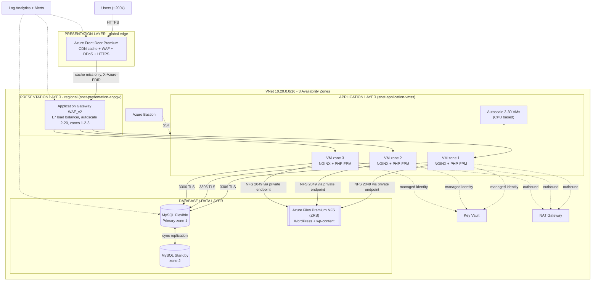

# Highly Available WordPress on Azure (Terraform)

A three-tier WordPress platform on Azure: presentation, application and database layers. It uses a global CDN, load balancing, auto scaling and a highly available MySQL database, and it is sized for about **200,000 users** with no single point of failure inside the region.

---

## 1. Architecture at a glance



### The three layers

| Layer | Azure services | Purpose |
|---|---|---|
| **Presentation** | Azure Front Door Premium (CDN + WAF), Application Gateway WAF_v2 | Terminates HTTPS at the edge, serves cached pages and images from about 190 global edge locations, blocks attacks, and load-balances cache misses across VMs. |
| **Application** | Linux VM Scale Set (Ubuntu 22.04, NGINX, PHP-FPM 8.1, WordPress) across 3 zones, autoscale | Runs WordPress PHP code. Stateless: any VM can serve any request. |
| **Database / Data** | Azure Database for MySQL Flexible Server (zone-redundant HA), Azure Files Premium NFS (ZRS) | Stores posts, users and settings (MySQL), plus uploads, themes and plugins (shared file share). |

---

## 2. How a request flows

1. A visitor opens `https://<site>`. DNS points to **Azure Front Door**, which answers from the nearest edge location.
2. Front Door's **WAF** checks the request (OWASP rules, bot protection, login rate limit). Bad traffic stops here.
3. If the page or asset is **in the edge cache**, Front Door returns it immediately. The origin is never touched. Most anonymous traffic is served this way.
4. On a **cache miss**, Front Door forwards the request to the **Application Gateway** public IP and adds the header `X-Azure-FDID` (your Front Door's unique ID).
5. The Application Gateway's **NSG** only allows the `AzureFrontDoor.Backend` service tag. Its **WAF custom rule** blocks any request whose `X-Azure-FDID` isn't yours. Nobody can bypass the CDN by hitting the IP directly.
6. The Application Gateway picks a **healthy VM** (probe on `/health.php`) in any zone and forwards the request on port 80.
7. NGINX on the VM passes PHP to **PHP-FPM**. WordPress reads its code and uploads from the **NFS share**, and queries **MySQL** over TLS on port 3306.
8. NGINX adds `Cache-Control: public, max-age=300` for anonymous visitors (or `no-store` for logged-in users and admin pages). On the way back, Front Door caches the response so the next visitors get it from the edge.

---

## 3. Step-by-step: what each file builds and how it connects

### Step 0 – `versions.tf`: Terraform and providers
* Pins Terraform ≥ 1.6 and the providers `azurerm ~> 4.20`, `random`, `tls` and `time`.
* Includes a commented-out **remote state backend** (Azure Storage). Turn it on for team use so state is locked and shared.
* `data "azurerm_client_config"` reads who is running Terraform (tenant and object ID), which is used for the Key Vault permissions.

### Step 1 – `main.tf`: Foundation
* Generates a random 5-character **suffix** so globally unique names (Key Vault, storage, Front Door) don't collide.
* Creates the **resource group** `rg-wp-prod-wordpress`. Every other resource lives in it.
* Creates the **Log Analytics workspace** that every diagnostic setting sends logs to (Step 10).

### Step 2 – `network.tf`: Network and isolation
One VNet, `10.20.0.0/16`, with **one subnet per tier**:

| Subnet | CIDR | What lives there | Inbound allowed (NSG) |
|---|---|---|---|
| `snet-presentation-appgw` | 10.20.0.0/24 | Application Gateway | Front Door (80/443), GatewayManager (65200-65535), Azure LB |
| `snet-application-vmss` | 10.20.1.0/24 | WordPress VMs | Port 80 from the App Gateway subnet, port 22 from Bastion only |
| `snet-database-mysql` | 10.20.2.0/24 | MySQL (delegated subnet) | Port 3306 from the app subnet only |
| `snet-data-private-endpoints` | 10.20.3.0/24 | Azure Files private endpoint | Port 2049 (NFS) from the app subnet only |
| `AzureBastionSubnet` | 10.20.4.0/26 | Azure Bastion | Managed by Azure |

* Each subnet has its own **NSG** that ends in an explicit *deny all*, so each tier can only talk to the tier next to it. This is the core of the three-tier security model.
* A **NAT Gateway** on the app subnet gives the VMs (which have **no public IPs**) outbound internet for `apt` and the WordPress download, from one fixed IP.
* **Azure Bastion** gives admins browser or CLI SSH to the VMs without exposing port 22 to the internet.

### Step 3 – `security.tf`: Identity and secrets
* **User-assigned managed identity** for the VMs. The VMs use it to sign in to Azure without any stored credential.
* **Key Vault** with RBAC, purge protection, and a firewall that allows only the app subnet (service endpoint) and your admin IPs.
* Role assignments: the deployer gets *Secrets Officer* (to write secrets) and the VM identity gets *Secrets User* (read only). A `time_sleep` waits for the RBAC change to propagate.
* Terraform generates a **32-character MySQL password** and an **SSH key pair**, and stores both in Key Vault. The password never appears in VM custom data. Each VM fetches it at boot with its identity.

### Step 4 – `frontdoor.tf`: Presentation layer, global edge (CDN)
* **Front Door Premium profile and endpoint.** This gives you the public hostname `*.azurefd.net`. You add your custom domain later.
* **Origin group and origin**: points at the Application Gateway public IP, health-probes `/health.php` every 30 s. To add a second region for DR, add another origin here.
* **Rule set (caching logic)**:
  1. `BypassAdmin`: never cache `wp-admin`, `wp-login.php`, `wp-json`, cron, xmlrpc or previews.
  2. `BypassLoggedIn`: never cache for visitors with `wordpress_logged_in`, comment or password cookies.
  3. `CacheStatic`: cache CSS, JS, images and fonts for 7 days, with compression.
  All other pages follow the origin's `Cache-Control` (5 minutes for anonymous visitors, set by NGINX).
* **Route**: `/*` goes to the origin group. HTTP is redirected to HTTPS, and compression is on.
* **Edge WAF policy** in Prevention mode: Microsoft Default Rule Set 2.1, Bot Manager, a **rate limit of 30 requests per minute per IP on `/wp-login.php`** (brute-force protection), and a block on `xmlrpc.php`.
* **Security policy**: attaches the WAF to the endpoint.

### Step 5 – `appgateway.tf`: Presentation layer, regional load balancer
* A zone-redundant **Standard public IP** in zones 1, 2 and 3.
* A **WAF policy** with OWASP 3.2 in Prevention mode, plus the custom rule **`AllowOnlyOurFrontDoor`**, which blocks requests without your Front Door ID. This is where Step 4 and Step 5 lock together.
* **Application Gateway WAF_v2**:
  * Deployed **across 3 zones** and **autoscales from 2 to 20 instances** by itself.
  * Backend pool `pool-wordpress-vmss`. It starts empty, and the scale set registers its VMs into it (Step 8).
  * Health probe `GET /health.php`. A VM that fails 3 times in a row stops receiving traffic.
  * Connection draining (60 s), so VMs being removed by scale-in or upgrades finish their in-flight requests.
  * Cookie affinity is **off**, because the web tier is stateless.

### Step 6 – `storage.tf`: Data layer, shared files
* **Premium FileStorage account with ZRS**, so data is copied synchronously across 3 zones.
* An **NFS 4.1 share** called `wordpress`. It holds WordPress core, `wp-config.php` and `wp-content` (uploads, themes, plugins). Because every VM mounts the same share, an image uploaded through VM #2 is instantly visible to VM #17.
* Public network access is **disabled**. VMs reach the share through a **private endpoint** in `snet-data-private-endpoints`, resolved by the private DNS zone `privatelink.file.core.windows.net`.

### Step 7 – `database.tf`: Database layer
* **MySQL Flexible Server 8.0** using **zone-redundant high availability**:
  * The primary runs in zone 1 and a **hot standby** in zone 2 with synchronous replication.
  * If the primary or its zone fails, Azure fails over automatically, typically within 60–120 seconds. The DNS name stays the same, so WordPress reconnects without any change.
  * `lifecycle.ignore_changes` on the zones, so Terraform doesn't try to "fix" the swap after a failover.
* **Private access only**: the server is injected into the delegated subnet, with a private DNS zone. It has no public endpoint.
* 35-day backups that are **geo-redundant** (copied to the paired region), storage auto-grow, auto-scaling IOPS, and a Sunday 04:00 maintenance window.
* A `wordpress` database (utf8mb4) and `max_connections = 1500` for many PHP workers.

### Step 8 – `compute.tf` and `templates/cloud-init.sh.tftpl`: Application layer
**VM Scale Set**
* Ubuntu 22.04 VMs, `Standard_D4s_v5` (4 vCPU, 16 GB), **balanced across zones 1, 2 and 3**, with no public IPs and accelerated networking.
* Each VM's NIC carries `application_gateway_backend_address_pool_ids`. **This single line is what connects the load balancer to the auto-scaling VMs.** Every new VM joins the App Gateway pool automatically, and removed VMs leave it.
* The **Application Health extension** reports `/health.php` status. **Automatic instance repair** replaces VMs that stay unhealthy.
* **Rolling upgrades** (20% at a time) and **automatic OS image upgrades** keep the fleet patched with no downtime.

**cloud-init (what every VM does at first boot)**
1. Installs NGINX, PHP-FPM 8.1 with WordPress extensions, and the NFS client.
2. Mounts the Azure Files NFS share at `/mnt/wpshared`, with retries.
3. Gets an access token from its **managed identity** and reads the MySQL password from **Key Vault**.
4. Takes a **`flock` lock on the share**. Only the *first* VM downloads WordPress and writes `wp-config.php` (DB settings, TLS, unique salts, `WP_HOME` set to the Front Door URL, HTTPS forced). Later VMs see it and skip this step.
5. Creates a local `/health.php`. It checks that the VM can run PHP and sees the share. It deliberately does **not** check MySQL, so a 60-second DB failover doesn't make every VM "unhealthy" at once.
6. Tunes PHP-FPM (60 workers) and OPcache.
7. Configures NGINX with the **Cache-Control logic** that makes Front Door caching work, and blocks `xmlrpc` and dotfiles.
8. Runs WP-Cron from system cron every 5 minutes, at a random offset per VM.

### Step 9 – `compute.tf` (autoscale): Auto scaling
* **Minimum 3 VMs** (one per zone, always on) and **maximum 30**.
* **Scale out by 3** (one per zone) when average CPU is above 60% for 5 minutes, with a 5-minute cooldown.
* **Scale in by 1** when average CPU is below 25% for 15 minutes, with a 10-minute cooldown.
* Scaling is fast going out and slow coming in, which avoids flapping during traffic spikes. An email goes out on every scale event.
* The Application Gateway scales on its own (Step 5), and Front Door is a global service that scales automatically.

### Step 10 – `monitoring.tf`: Observability
* Diagnostic logs from App Gateway, Front Door, MySQL and Key Vault go to Log Analytics.
* Email alerts:
  * **Unhealthy hosts** behind App Gateway (severity 1)
  * **More than 100 backend 5xx errors** in 5 minutes (severity 1)
  * **MySQL CPU above 80%** (severity 2)
  * **VMSS CPU above 85%** sustained, which means autoscale is at its limit (severity 2)

### Outputs – `outputs.tf`
Site URL, setup URL, App Gateway IP, MySQL FQDN, Key Vault name, VMSS name and the NAT outbound IP.

---

## 4. "The site shouldn't go down": how each failure is handled

| Failure | What happens | User impact |
|---|---|---|
| One VM crashes | Health probe fails, App Gateway stops sending to it, auto-repair replaces it | None |
| A whole availability zone goes down | The other 2 zones keep serving. App Gateway, the public IP, storage (ZRS) and MySQL HA are all zone-redundant. Autoscale adds VMs in the remaining zones. | None, or a brief slowdown |
| MySQL primary fails | Automatic failover to the zone 2 standby. Same hostname. | About 1–2 minutes of errors on uncached and logged-in pages. **Cached pages keep being served by Front Door.** |
| Traffic spike (for example, a campaign launch) | Front Door absorbs it at the edge, App Gateway autoscales, VMSS adds 3 VMs every 5 minutes | Higher latency for a few minutes at most |
| DDoS or bot flood | Front Door's edge capacity, WAF and Bot Manager filter it | None |
| Brute force on wp-login | Rate limit blocks the IP after 30 requests per minute | None |
| OS patching | Automatic OS upgrades roll 20% of VMs at a time, with health gating | None |
| A bad deployment or plugin update | Restore MySQL to a point in time (35 days), and use snapshot or backup restore for the share | Depends on the issue |
| **Entire Azure region down** | **Not covered by this single-region build.** See section 7. | Outage, unless DR is added |

> **Realistic expectation:** this design removes every single point of failure *within one region*. The combined SLA of the zone-redundant components is in the 99.9x% range. No cloud design can promise "never down". For region-level resilience, add the second-region option in section 7.

---

## 5. Capacity planning for 200,000 users

The traffic numbers below are **assumptions**. Replace them with your analytics data and confirm with a load test.

| Assumption | Value |
|---|---|
| Users active at peak | 200,000 (worst case: all concurrent) |
| Page views per user | 1 every 30 seconds |
| Peak page requests | about 6,700 per second |
| Front Door cache hit ratio for HTML (anonymous) | about 90% |
| Requests that reach the origin | about 700 per second (plus logged-in and admin traffic) |
| Uncached WordPress requests per D4s_v5 VM | about 40–80 per second (depends on theme and plugins) |
| **VMs needed at peak** | **about 10–18**, within the autoscale range of 3–30 |

* Static assets (images, CSS, JS) are about 80–90% of all requests and are served **entirely from the CDN**.
* If 200,000 means *daily* users, peak concurrency is much lower, and the minimum of 3 VMs will often be enough.
* **Load-test before go-live**, for example with Azure Load Testing (JMeter or Locust) against the Front Door URL. Then tune `vmss_max_instances`, `vmss_sku`, `mysql_sku` and `pm.max_children`.
* If MySQL CPU becomes the bottleneck, add a **Redis object cache** (see section 7) and/or move to a Business Critical `MO_` SKU.

---

## 6. Deploying

### Prerequisites
* Terraform ≥ 1.6, Azure CLI, and permission to create resources and **role assignments** (Owner, or Contributor plus User Access Administrator) on the subscription.
* Providers registered: `Microsoft.Cdn`, `Microsoft.DBforMySQL`, `Microsoft.Network`, `Microsoft.Compute`, `Microsoft.Storage`, `Microsoft.KeyVault`, `Microsoft.Insights`.
* Enough vCPU quota for Dsv5 VMs in the region: 30 VMs × 4 vCPU = **120 vCPU** at maximum scale.

### Commands
```bash
az login
az account set --subscription "<subscription-id>"

cp terraform.tfvars.example terraform.tfvars   # edit values
curl -s ifconfig.me                            # put this IP in admin_ip_ranges

terraform init
terraform fmt -recursive
terraform validate
terraform plan -out tfplan
terraform apply tfplan                         # takes about 25-40 minutes (MySQL HA and App Gateway are slow)
```

### After apply
1. Wait about 5–10 minutes for the VMs to finish cloud-init. Check **App Gateway → Backend health**: every instance should be *Healthy*.
2. Open the `wordpress_setup_url` output. Choose the site title and admin user, and use a **strong password plus MFA** (via a plugin).
3. Note that Front Door can take a few minutes to roll out globally after the first apply.
4. **Custom domain**: add `azurerm_cdn_frontdoor_custom_domain` (with managed certificate) and its association to the route, create the DNS CNAME and TXT validation records, then update `WP_HOME` and `WP_SITEURL` in `wp-config.php` on the share.

### Getting onto a VM
```bash
az keyvault secret show --vault-name <kv> -n vmss-ssh-private-key --query value -o tsv > wp.pem && chmod 600 wp.pem
az network bastion ssh --name bas-wp-prod --resource-group rg-wp-prod-wordpress \
  --target-resource-id <vmss-instance-id> --auth-type ssh-key --username wpadmin --ssh-key wp.pem
sudo tail -f /var/log/wp-bootstrap.log
```

---

## 7. Hardening and next steps (recommended before production)

1. **End-to-end TLS**: put a certificate (from Key Vault) on an App Gateway HTTPS listener, then switch the Front Door route to `forwarding_protocol = "HttpsOnly"`. Today, traffic between Front Door and the App Gateway is HTTP inside the Microsoft backbone, locked by the NSG and FDID check.
2. **Least-privilege DB user**: create a dedicated `wpuser` with rights only on the `wordpress` database, and stop using the admin account in `wp-config.php`.
3. **Redis object cache**: add Azure Managed Redis with a private endpoint and the *Redis Object Cache* plugin. This greatly reduces MySQL load for logged-in and dynamic traffic.
4. **Front Door → App Gateway Private Link**: Front Door Premium supports a private origin, which removes the App Gateway public IP entirely.
5. **Backups for the file share**: enable Azure Backup or scheduled snapshots for the NFS share (uploads and plugins).
6. **Multi-region DR**: deploy this same module into a paired region (for example, Central US) with a MySQL **cross-region read replica**, and add the second App Gateway as a lower-priority Front Door origin. Front Door then fails over automatically.
7. **WAF tuning**: run both WAFs in *Detection* mode for a week, review the logs for WordPress false positives (Gutenberg editor and some plugins trigger OWASP rules), add exclusions, then return to Prevention.
8. **Defender for Cloud**: enable Defender for Servers, Databases and Storage, and Azure Policy (CIS and NIST) on the resource group.
9. **CI/CD**: run `terraform plan` on pull requests and `apply` on merge, using a service principal or OIDC federated identity and the remote backend.
10. **Scheduled scaling**: add an autoscale profile with a higher minimum during known peak windows (for example, campaign days).

---

## 8. File map

```
azure-wordpress-terraform/
├── versions.tf                 # Step 0  providers, backend
├── variables.tf                # all inputs
├── main.tf                     # Step 1  RG, naming, Log Analytics
├── network.tf                  # Step 2  VNet, subnets, NSGs, NAT, Bastion
├── security.tf                 # Step 3  identity, Key Vault, secrets
├── frontdoor.tf                # Step 4  CDN, edge WAF, caching rules
├── appgateway.tf               # Step 5  L7 load balancer + WAF
├── storage.tf                  # Step 6  Azure Files NFS + private endpoint
├── database.tf                 # Step 7  MySQL Flexible zone-redundant HA
├── compute.tf                  # Step 8-9 VM Scale Set + autoscale
├── templates/cloud-init.sh.tftpl  # VM bootstrap (NGINX/PHP/WordPress)
├── monitoring.tf               # Step 10 diagnostics + alerts
├── outputs.tf
├── terraform.tfvars.example
└── .gitignore
```

> **Note:** this code targets `azurerm` 4.x. Run `terraform validate` and `terraform plan` in your environment first. Some argument names change between minor provider versions, and `plan` will flag any mismatch.
